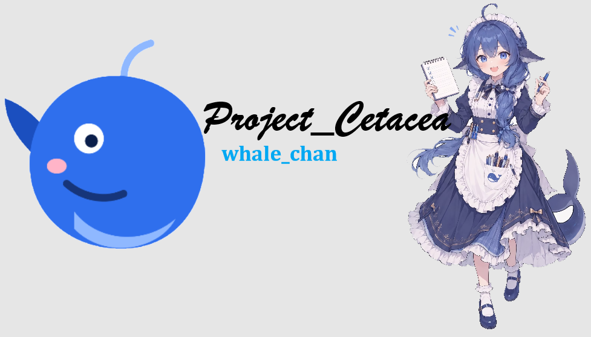

# 🐋 Project_Cetacea（鲸鱼娘）— v0.4.0

> 本文件是**根 README 的候选稿**：复制到仓库根目录并改名为 `README.md` 后，
> 文中的相对链接（`app/`、`companion/`、`relay/`、`assets/`）才会生效。
> 复制命令见 [GITHUB-0.4.0.md](GITHUB-0.4.0.md) 第 3 节。




> “哼，本鲸鱼才不是大肥鱼！Master，今天要让我帮你干点啥？”

**鲸鱼娘（WhaleChan）** 是一个运行在 Android 端的端侧自动化 Agent。她常驻后台，用你配置的 LLM 思考，
通过无障碍服务替你操作手机（打开 QQ、发消息、刷视频），通过通知监听知道谁找了你。

从 v0.4.0 起，她学会了**克制**：不再疯狂刷屏、不再重复评论同一条动态、不再复读同一句话；
也终于能穿过**校园网 AP 隔离**，让遥控端在另一张网络上找到她。

当前版本：**v0.4.0**（versionCode 5，协议 v2）

---

## ⚠️ 重要声明（新手必读）

> 1. 项目仍处测试阶段，请优先在**备用机**上使用。
> 2. Agent 由 LLM 驱动，可能误触广告、误发消息；**完全信任模式（FULL_TRUST）不可撤销**。
> 3. 节流与复读熔断只能降低刷屏概率，不能保证 100% 不重复。
> 4. 自动化操作可能违反 QQ、抖音等平台的用户协议，账号风险自负。
> 5. 公网中继不设 `RELAY_TOKEN` 等于把手机控制权交给任何人。

---

## ✨ v0.4.0 新东西

| 能力 | 说明 |
| :--- | :--- |
| 🚦 **社交节流** | 同一好友 30 秒 1 条、全局 1 分钟 3 条；说说 24 小时 2 条；同一条动态评论 1 次；转发 30 分钟 10 次 |
| 🧠 **实体记忆** | 聊天页提取 `[CurrentEntity]`；最近 30 分钟社交动作注入 `[RecentActivity]`，避免重复 |
| ✂️ **分段发送** | 回复拆成 ≤15 字短句，间隔 1.5~3 秒逐条发，每条都做“已出现在聊天列表”的判定 |
| 📥 **通知冷却信箱** | 刷视频时 QQ 消息先排队，当前任务结束再处理，不再“心不在焉” |
| 🌐 **公网中继** | 手机主动连 `wss://` 中继，按 6 位配对码跨网通信，校园网也能用 |
| 🔁 **复读熔断** | 与最近 3 条已发文本相似度 ≥80% 直接拦截 |
| 🚪 **结束离场** | 任务完成后若还停在 QQ/TIM，主动回桌面 |
| 🛡️ **完全信任 + 节流** | FULL_TRUST 也不能绕过社交冷却；只拦频率，不做价值判断 |

---

## 📦 两个 App，名字要分清

| | 🐋 **鲸鱼娘**（手机端） | 📱 **鲸鱼娘·遥控**（遥控端） |
| :--- | :--- | :--- |
| 安装包 | `app-debug.apk` | `companion-debug.apk` |
| 包名 | `com.whalechan.agent` | `com.whalechan.companion` |
| 作用 | 真正执行任务 | 聊天 / 派活 / 发图片文件 / 看状态 |
| 权限 | 无障碍、通知监听、电池白名单 | 仅网络 |
| 是否必需 | 必需 | 可选 |
| 手册 | [app/README.md](app/README.md) | [companion/README.md](companion/README.md) |

---

## 🚀 快速开始

1. **装 App**：手机端 `app-debug.apk`；遥控端（可选）`companion-debug.apk`。
2. **配大脑**：设置页填 Base URL / API Key / Model ID →「测试连接」。
3. **给权限**：无障碍 → 通知使用权 → 电池优化白名单 →（可选）悬浮窗。
4. **启服务**：首页「启动常驻服务」。
5. **下任务**：聊天框输入，例如 `打开QQ，给置顶好友发一句晚安`。
   「允许我动手」默认开启：发出去的话会当任务执行，关掉只聊天。

> 详细权限表、三档步数策略、错误分类见 [app/README.md](app/README.md)。

---

## 📡 遥控端怎么连

### 方式 A：公网中继（推荐，校园网/蜂窝网可用）

1. 部署 [`relay/server.js`](relay/README.md)，拿到 `wss://你的域名/ws` 与 `RELAY_TOKEN`；
2. 手机端设置页 ⑥ 打开「公网中继」，填地址与令牌，记下 6 位配对码；
3. 遥控端填同一个地址、令牌、配对码。

### 方式 B：局域网直连（同一 Wi-Fi）

手机端打开「WebSocket 服务端」（默认 8787），遥控端填 `192.168.x.x:8787` + 手机配对码，
中继配对码留空。校园网有 AP 隔离时直连必失败，请用方式 A。

---

## 🧠 架构简图

```text
[用户指令 / QQ 通知 / 遥控端 COMMAND]
        ↓
[AgentEngine]
  ├─ CurrentEntity + RecentActivity
  ├─ ActionRateLimiter（社交冷却，FULL_TRUST 也拦）
  ├─ TextSimilarity（复读熔断）
  ├─ LLM 规划 → ActionExecutor（无障碍点击/滑动/输入）
  └─ 每步落库（Room）
        ↓
[手机屏幕]

[鲸鱼娘·遥控] ──wss──▶ [relay] ◀──wss── [鲸鱼娘]
        └──────── 同一 pairCode ────────┘
```

---

## 📚 文档导航

| 文档 | 内容 |
| :--- | :--- |
| [app/README.md](app/README.md) | 手机端手册：权限、节流、分段、中继、排错 |
| [companion/README.md](companion/README.md) | 遥控端手册：两种连接、界面、协议 |
| [relay/README.md](relay/README.md) | 中继部署：Node.js / Nginx wss / Docker |
| [CHANGELOG.md](CHANGELOG.md) | 版本变更记录 |
| [SECURITY.md](SECURITY.md) | 威胁模型与私密漏洞报告 |
| [CONTRIBUTING.md](CONTRIBUTING.md) | 构建、代码约定、PR 规则 |

---

## 🐛 常见问题

- **一直弹 `ActionRejected: Cooldown`**：这是节流，不是故障；等冷却或换目标。
- **她说“这句话刚说过”**：复读熔断；换个话题或结束任务。
- **刷视频时消息没回**：在 `PendingInbox` 排队，任务结束会自动处理。
- **遥控端连不上**：校园网用中继；直连要同一 Wi-Fi 且填 `192.168.x.x`，不要填 `10.x`。
- **中继连上但没反应**：检查两端 `RELAY_TOKEN` 与配对码是否一致。
- **打不开某个 App**：看日志里的 `APP_LAUNCH_TIMEOUT`，通常停在开屏广告/登录页。
- **停不下来**：聊天页「停」；遥控端也有停止按钮。

---

## 🤝 反馈与贡献

Bug 或新点子请提 Issue；提交 PR 前看 [CONTRIBUTING.md](CONTRIBUTING.md)；
安全相关问题请走私密报告（[SECURITY.md](SECURITY.md)），不要开公开 issue。

## License: MIT
## Built with ❤️ by [Yowane-Hakudesu]
